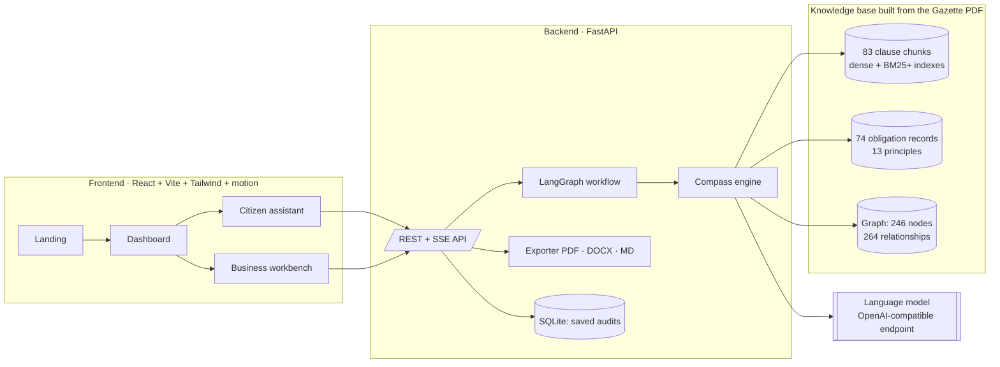
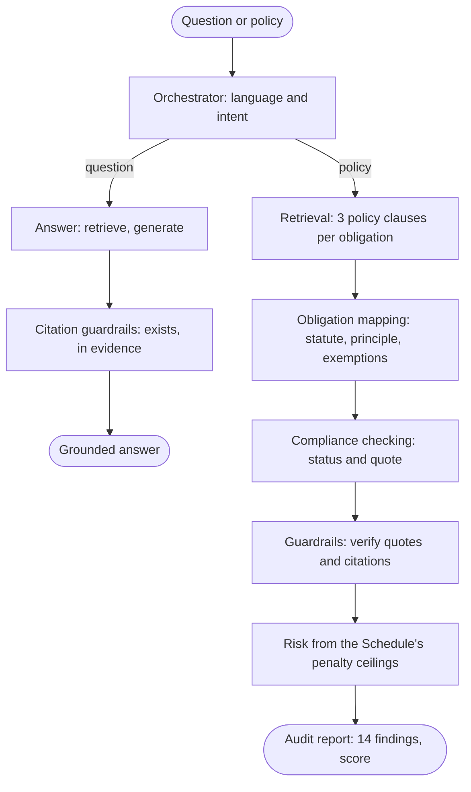
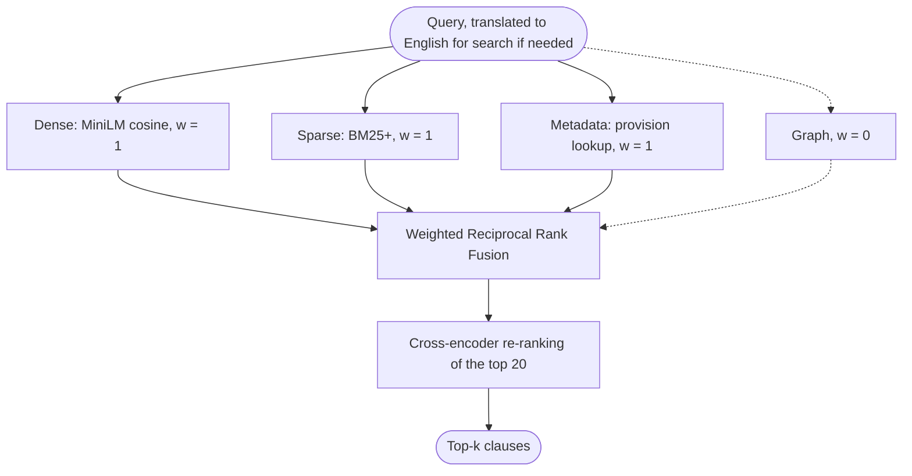

# DPDP Compass: Project Documentation

_Status as of 10 October 2026_

DPDP Compass answers questions about India's **Digital Personal Data Protection Act, 2023** and audits privacy policies against it. Every legal citation is attached by the system from its knowledge base of the Act, not written by the language model.

| Audience | What they can do |
|---|---|
| **Citizens** | Ask about their data rights in English, Hindi or Marathi; check what an app's privacy policy says. |
| **Businesses** | Audit a privacy policy against 14 obligations of a Data Fiduciary, with the law and the policy quoted side by side; generate a draft policy; export reports as PDF, Word or Markdown. |

---

## 1. Architecture



### Agent workflow (`app/compass/workflow.py`)



If the language model is unavailable, the audit falls back to keyword rules and a question returns the retrieved provisions. Both are marked as degraded in the response and in the web app.

### Retrieval (`app/compass/retrieval.py`)



The fusion weights were chosen on the development split of DPDP-QA. The graph lowered ranking quality at every weight tried, so it is not used for ranking; it links obligations to exemptions and provisions to penalties.

---

## 2. Components

### Engine (`project/backend/app/compass`)

| Module | Job |
|---|---|
| `statute.py` | Clause-aware chunker for the Gazette PDF. Separates body text from margin notes by font size, requires section and sub-section numbers to run in sequence, packs sub-sections up to 1,200 characters, and rebuilds the penalty Schedule row by row. |
| `layers.py` | Layer 1 facts (chunks, 28 definitions), Layer 2 obligations (actor + shall / shall not / shall have the right / may), Layer 3 principles, and the graph. Every edge carries its provision, page and sentence. |
| `retrieval.py` | The four retrievers, weighted RRF and re-ranking, behind one `Index.search()` call. |
| `checklist.py` | The 14 obligations with their provision and the tests for Satisfied and Partial. |
| `audit.py` | Policy chunking, per-obligation clause retrieval, obligation mapping, compliance checking, guardrails, risk. |
| `qa.py` | Grounded answers with citation guardrails; language detection. |
| `workflow.py` | The LangGraph state machine and the degraded fallbacks. |
| `adapter.py` | Maps engine output to the API shapes the web app uses. |
| `llm.py` | Model client: temperature 0, key failover, on-disk response cache. |
| `sources.py` | Registry of the official documents (Act; Rules G.S.R. 846(E); commencement G.S.R. 843(E); corrigendum G.S.R. 892(E)) with sha256; the Rules parser (23 rules, 7 schedules, corrigendum applied); the commencement date of every provision. |
| `applicability.py` | The four questions that decide which obligations apply. Exemptions that need a government notification are reported, never applied. |
| `claims.py` | Sentence-level support of an answer by its sources (supported, partly, not found, contradicted) and clauses of one policy that contradict each other. A word-overlap heuristic. |
| `redline.py` | Proposed wording for a finding, anchored to exact characters of one document version; applying it; sentence-level diff. |
| `intake.py` | Reads a business's answers before a policy is drafted: follow-up questions where an answer is missing or vague, and recommendations prompted by what it says, each with its provision. |
| `rights_requests.py` | Letters for the six rights, addressed to a contact quoted from the company's policy text. |

### The 14 obligations audited

| # | Obligation | Section |
|---|---|---|
| 1 | Notice of data and purpose | 5(1) |
| 2 | Free, specific and informed consent | 6(1) |
| 3 | Plain language and choice of language | 6(3) |
| 4 | Withdrawal of consent | 6(4) |
| 5 | Data Processors under a valid contract | 8(2) |
| 6 | Accuracy of personal data | 8(3) |
| 7 | Reasonable security safeguards | 8(5) |
| 8 | Intimation of a personal data breach | 8(6) |
| 9 | Erasure and retention | 8(7) |
| 10 | Published contact for privacy questions | 8(9) |
| 11 | Grievance redressal mechanism | 8(10) |
| 12 | Children's personal data | 9(1) |
| 13 | Access to and correction of personal data | 11(1) |
| 14 | Right to nominate | 14(1) |

Score = 100 × (Satisfied + 0.5 × Partial) ÷ applicable obligations (method `dpdp-coverage` v1.0 in `checklist.py`; the business audit, citizen check and policy scanner all use it). Each obligation is also mapped to the DPDP Rules, 2025 that detail it, and carries its commencement date and status ("In force" or "Not yet in force") on the chosen assessment date; that status does not change the score.

### First-release features (from `FEATURE_RESEARCH.md`)

| Feature | Where | What the user gets |
|---|---|---|
| 1 Legal library and effective dates | `sources.py`, `/api/compass/sources` | Every audit names its sources and assessment date; a date picker shows readiness today or on 13 May 2027 |
| 2 Applicability questions | `applicability.py` | Role, grounds, children and notification answers mark obligations Not applicable, with the reason |
| 3 Evidence viewer | `components/EvidenceViewer.tsx` | The audited document version with the quote, the passages read and contradicting clauses highlighted, beside the law and Gazette page links |
| 4 Redlining and re-audit | `redline.py`, `components/Redline.tsx` | Proposed wording (model or model clause with [placeholders]), edit, accept to save a new version and re-audit on the same terms |
| 5 Version comparison | `/api/compliance/compare/{a}/{b}`, `/api/policies/{id}/compare/{a}/{b}` | Score change, obligations improved or regressed, sentence-level text changes, and a warning when the two audits are not comparable |
| 8 Reviewer decisions | `components/ReviewControls.tsx` | Accept or override (with a reason) beside the model's verdict; append-only trail; a stale edit is refused (409) |
| 9 Claim checks | `claims.py`, `components/ClaimCheckPanel.tsx` | Citizen answers and Act answers checked sentence by sentence; contradicting policy clauses flagged on the finding |
| 20 Rights-request letters | `rights_requests.py`, `components/RequestBuilder.tsx` | Letter for access, correction, erasure, withdrawal, grievance or nomination; copy or download; nothing is sent |
| Foundation: documents | `api/policies.py` | Uploads and pasted policies are private to their owner, versioned with sha256, and named by every audit |

### Guardrails

| Check | Action on failure |
|---|---|
| Policy quote found word for word in the policy | Satisfied becomes Partial; confidence capped at 0.5 |
| Partial finding has policy evidence | Partial becomes Missing |
| Cited provision exists in the Act | Citation removed |
| Provisions cited in an answer are in the retrieved evidence | One rewrite requested; result flagged |
| Retrieved text contains instruction-like content | Flagged; retrieved text is always passed as data |
| Confidence within 0-1; output schema complete | Clamped or flagged |

Personal data in a question (introduced names, phone numbers, email addresses, identity numbers) is redacted before processing and logging.

### Other backend modules

| Area | Files | Job |
|---|---|---|
| API | `api/compliance.py`, `api/compass.py`, `api/citizen.py`, `api/policies.py`, `api/documents.py`, `api/export.py` | REST and SSE endpoints |
| Hardening | `hardening.py` | Request ids, JSON access logs, security headers, size limit, safe errors, `/ready` |
| Citizen flow | `agents/*`, `graph/workflow.py` | Streaming answers and app-policy checks; legal evidence comes from the engine |
| Services | `services/exporter.py`, `services/pdf_analyzer.py` | PDF, DOCX and MD export; policy parsing |

### Frontend (`project/frontend/src`)

| Area | Files | Job |
|---|---|---|
| Shell | `App.tsx`, `components/layout/Layout.tsx` | Landing page at `/`; sidebar app shell elsewhere |
| Landing | `pages/Landing.tsx`, `components/landing/*` | Animated overview of the system |
| Pages | `Dashboard`, `CitizenChat`, `BusinessChat`, `Evaluation`, `About` | Product screens |
| Design system | `index.css`, `tailwind.config.js`, `components/ui/*` | Light and dark themes, Radix-based components |

### API

| Method | Path | Purpose |
|---|---|---|
| GET | `/health`, `/ready` | Liveness; readiness of the knowledge base |
| POST | `/api/auth/signup`, `/login`, `/logout`, `/password`, `/delete` | Accounts and sessions |
| GET, PATCH | `/api/auth/me` | The signed-in user; update the display name |
| GET, PUT | `/api/me/state`, `/api/me/state/{key}` | Work saved to the account |
| POST | `/api/compliance/analyze` | Audit a policy; optional `as_of`, `applicability`, `version` |
| GET | `/api/compliance`, `/api/compliance/{id}` | Saved audits, with reviewer decisions and activity |
| POST | `/api/compliance/{id}/findings/{fid}/review` | Accept, override or clear (needs the current `rev`) |
| POST | `/api/compliance/{id}/findings/{fid}/redline`, `/redline/accept`, `/redline/reject` | Propose wording; apply it as a new version and re-audit; reject |
| GET | `/api/compliance/compare/{a}/{b}` | What changed between two audits |
| GET, DELETE | `/api/policies`, `/api/policies/{id}` | The caller's documents and their versions |
| GET, POST | `/api/policies/{id}/versions/{n}`, `/api/policies/{id}/versions` | A version's text; add a version |
| GET | `/api/policies/{id}/compare/{a}/{b}` | Text changes between two versions |
| GET | `/api/compass/sources`, `/api/compass/sources/{doc}/file` | Official sources, commencement on a date; the Gazette PDF |
| GET | `/api/compass/applicability` | The applicability questions |
| GET, POST | `/api/citizen/requests/types`, `/api/citizen/requests/draft` | Rights-request letters |
| POST | `/api/compass/ask` | Grounded answer from the Act |
| POST | `/api/compass/audit` | Audit, engine output as-is |
| GET | `/api/compass/kb` | Knowledge-base counts |
| POST | `/api/citizen/analyze`, `/analyze/stream` | Citizen answer (JSON or streamed) |
| POST | `/api/policies/upload`, `/generate` | Upload a policy; draft one (asks follow-up questions first when answers are thin; `proceed: true` drafts with [placeholders]) |
| POST | `/api/export` | Markdown to PDF, DOCX or MD |

---

## 3. Evaluation

Experiments live in `project/backend/eval` and write to `eval/results`. Model calls are cached on disk, so each command resumes where it stopped.

| Dataset | Contents |
|---|---|
| **DPDP-QA** (`eval/dpdp_qa.py`) | 198 questions: 178 English, 12 Hindi, 8 Marathi; 16 unanswerable. Each answerable item has a gold provision and an evidence phrase, validated to occur only in that provision. Development 60, test 138. |
| **DPDP-Synth** (`eval/synth.py`) | 40 synthetic policies with labels known by construction (560 obligation-level labels), 78 hard negatives, 8 with a prompt-injection sentence. |

Both were drafted from the Act's text and have not been reviewed by a lawyer.

### Measured results

| Experiment | Result |
|---|---|
| Chunking (109 English test questions) | Clause-aware MRR 0.739; fixed windows of the same size 0.650; whole sections 0.697 |
| Fusion weights (58 development questions) | Metadata weight 1; graph weight 0 (nDCG@10 fell from 0.870 to 0.730 as the graph weight rose to 1) |
| Retrieval (124 test questions) | Full system Hit@1 0.790, Hit@5 0.960, nDCG@10 0.898; dense only 0.548, 0.855, 0.725 |
| Triplet extraction (60 sampled, checked by an LLM) | Precision 0.82 (95% CI 0.72 to 0.92) |
| Policy audit (40 policies, 560 labels) | Pipeline with guardrails: accuracy 0.857, kappa 0.784; single prompt 0.875 / 0.811 at about half the tokens; keyword rules 0.725 / 0.576 |
| Question answering (138 test questions) | Full system 88.7% correct (93.5% with partial credit), against 12.1% for the model without retrieval; no fabricated provisions; abstains on 78.6% of unanswerable questions |

Evaluation runs on the Act alone (`get_engine()`), with the original prompt, so these numbers stay comparable; the live app adds the Rules (`get_engine(rules=True)`).

The paper is rebuilt from these result files by `docs/paper/build_paper.py`.

---

## 4. Current status

| Check | Result |
|---|---|
| Backend tests | 114 passed (`MOCK_LLM=true python -m pytest tests -q`) |
| Frontend typecheck, lint, build | Pass |
| Live audit and question answering through the engine | Working |
| Degraded mode when the model is unavailable | Working, and shown in the web app |
| Accounts: sign-up, sign-in, saved work per user, account deletion | Working |
| First release (features 1, 2, 3, 4, 5, 8, 9, 20; private versioned documents; one scoring method) | Working; checked in the browser with the model mocked |
| Production hardening | In place (see `OPERATIONS.md`) |

### Known limitations

- Accounts are email and password only: no email verification, password reset by email or social sign-in yet.
- One API worker: the rate limiter and the SQLite audit store are per-process.
- The Rules are summarised per obligation and retrievable in answers; the audit's verdicts still test the Act's wording, not each rule's detail.
- Claim checks compare words, not meaning: a paraphrase can show as "partly supported".
- Reviews are per owner; there are no teams or reviewer roles yet.
- Rights-request contacts come from the bundled copies of company policies, which may be out of date; the letter says so.
- The Docker images are written but have not been built on the development machine.
- The citizen assistant's app-policy check still uses the earlier reference-policy data; its legal evidence comes from the engine.
- On a free model tier, daily token limits cap how many audits can run with the model in a day.
- The system gives guidance, not legal advice.

---

## 5. Roadmap

1. **Evidence:** finish the audit and question-answering experiments; have a lawyer review DPDP-QA and the checklist tests; label real privacy policies with annotators who have legal training.
2. **Coverage:** test each obligation against its rule's detail (for example the 72-hour report in Rule 7), not only the Act's wording.
3. **Product:** email verification and password reset; move the citizen app-policy check onto the engine; audit long real-world policies.
4. **Scale:** PostgreSQL for audits, Redis for rate limiting, more than one API worker.

---

## 6. Running locally

```bash
cd project/backend
python -m uvicorn app.main:app --host 127.0.0.1 --port 8001
```

```bash
cd project/frontend
API_TARGET=http://127.0.0.1:8001 npx vite --port 3001
```

In `project/backend/.env`, set `LLM_API_KEY`, `LLM_BASE_URL` and `LLM_MODEL`. Set `MOCK_LLM=true` to run without a key.

Production deployment, configuration and monitoring are in `docs/OPERATIONS.md`.

_DPDP Compass gives educational guidance, not legal advice._
